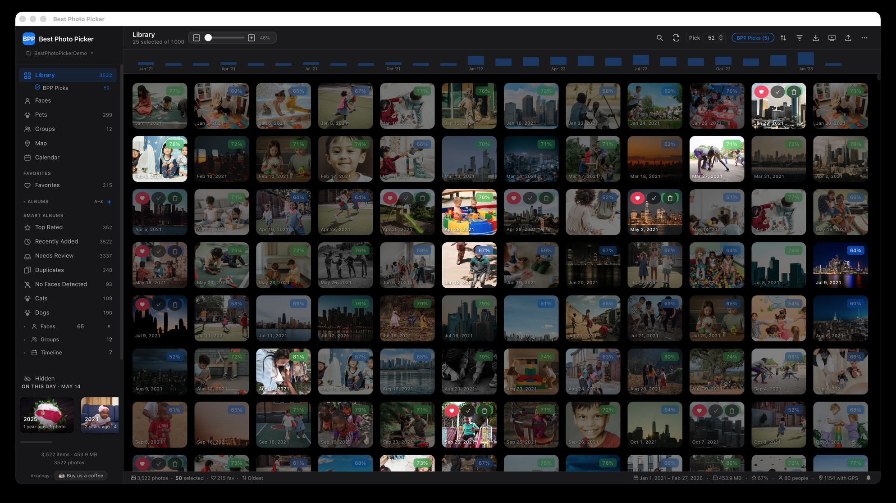
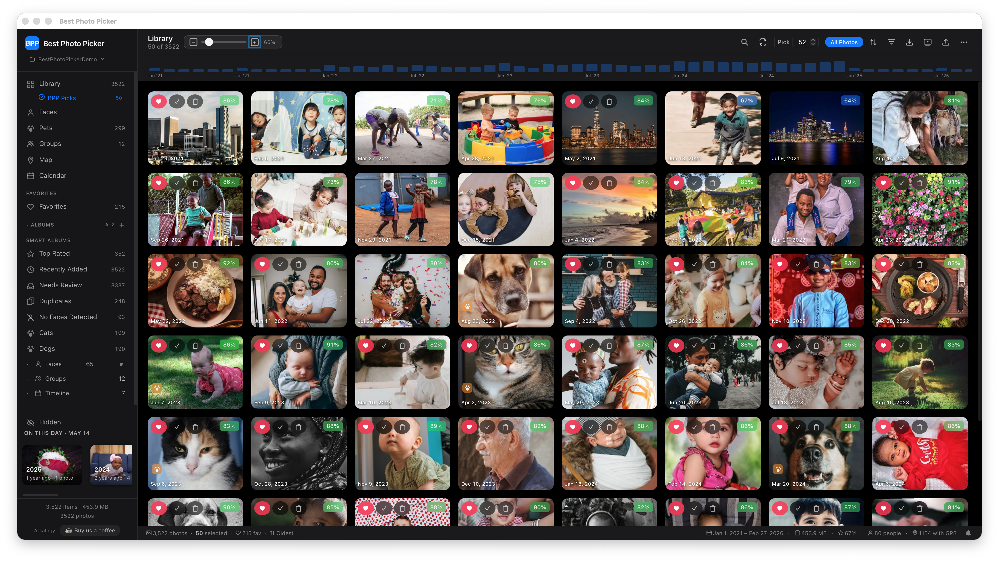
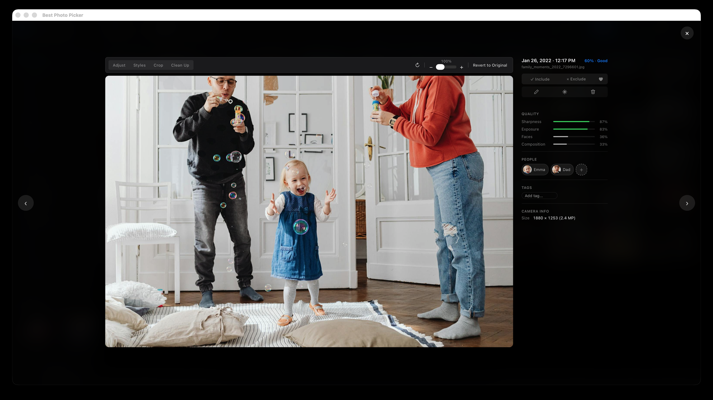
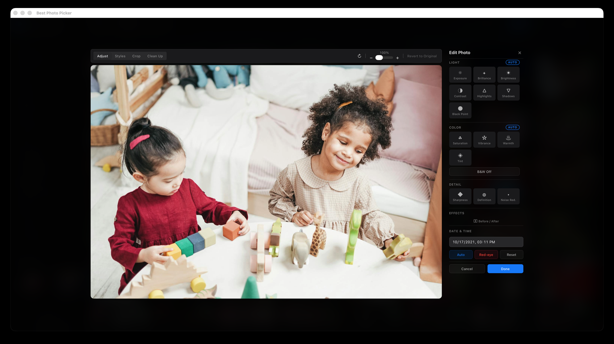
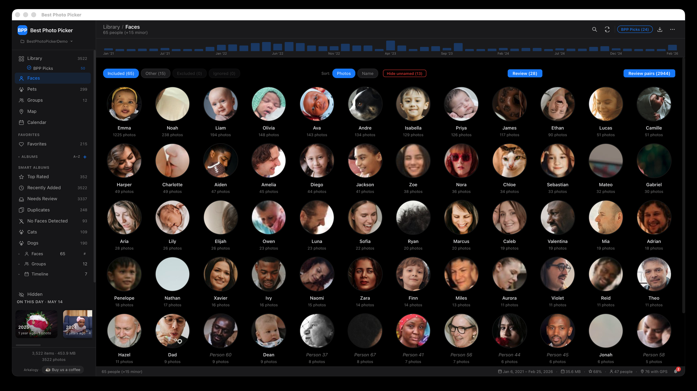
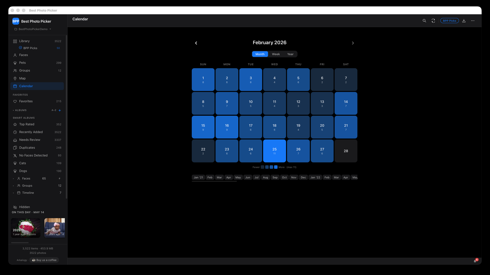
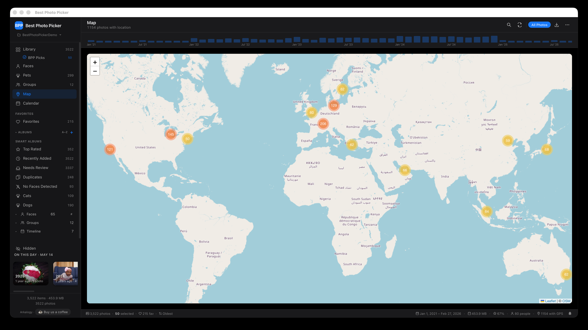
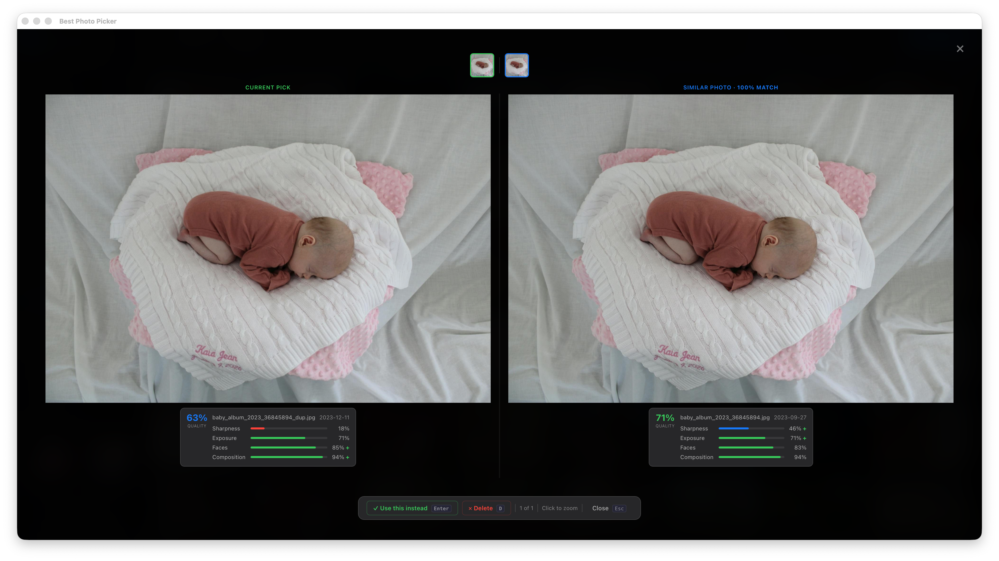
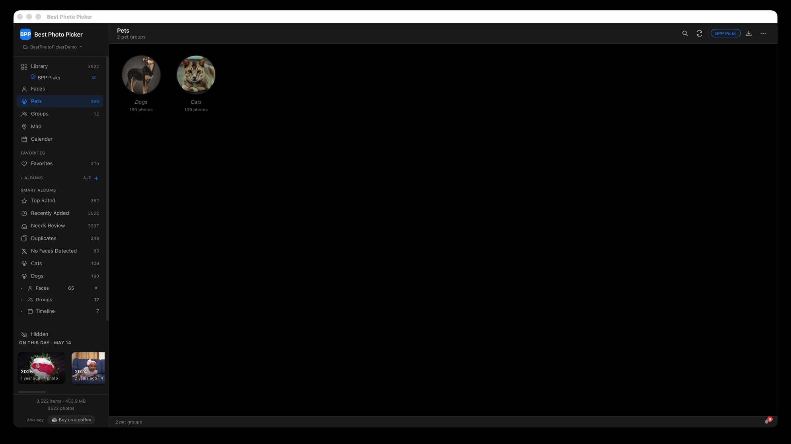
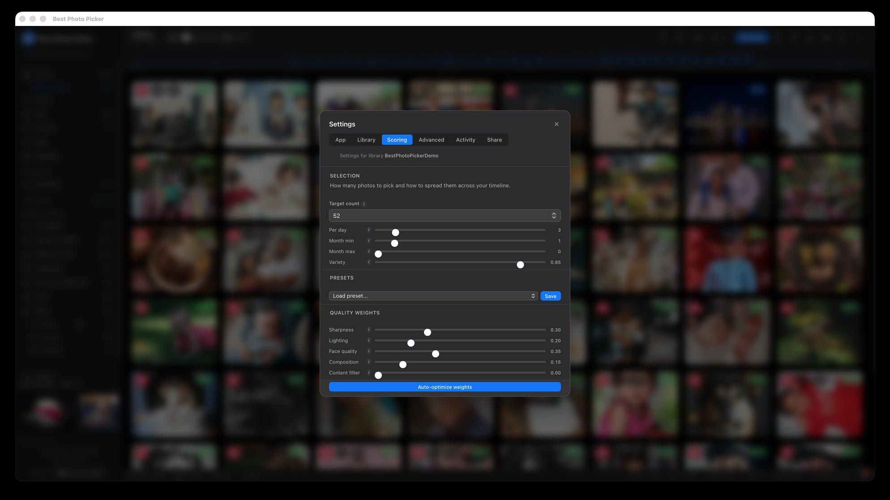

# Best Photo Picker — Visual Quickstart

A walkthrough of what BPP actually looks like in use. If you want to evaluate the product without running `pip install` first, this page is the next-best thing — it covers the core flow from import through pick and export, plus the side surfaces (faces, calendar, map, duplicates) that make a large library navigable.

For a 30-second hands-on trial with no setup, run:

```bash
pip install "bppicker[web]" && bpp demo
```

That generates a synthetic library and launches the full UI locally. Your photos are never uploaded; the few network calls bpp does make (model registry check, model downloads, update check, map tiles) are listed in the README's [Privacy](../README.md#privacy) section.

---

## 1. Library grid



The grid is the home view: every photo in your library, with score badges in the corner of each thumbnail. Sort by date, score, or filename. Filter by selected / favorited / overridden / enhanced / RAW / video. Multi-select with Cmd-click for batch ops. The sidebar on the left is the album list — smart albums (Picks, Faces, Pets, Duplicates, Calendar, Favorites) plus any manual albums you've created.

## 2. BPP Picks — your best photos in one click



Picks is the headline feature: select the best K photos across the entire library by an aggregate score (sharpness + exposure + faces + composition), with per-day caps and monthly coverage so the selection stays temporally diverse instead of clumping into the best-lit afternoon. The toolbar at the top shows the active K, the picks-only filter chip, and the live recompute trigger. Adjust the scoring weights with the sliders — picks rebuild in real time.

## 3. Lightbox — full-size review



Press space or click a thumbnail to open the lightbox. Keyboard navigation (arrows for prev/next, escape to close). The right pane shows the per-photo metadata: aggregate score breakdown, EXIF, GPS, faces detected, similar photos. The toolbar below the image carries the per-photo actions (favorite, override include/exclude, edit, delete).

## 4. In-place editor



Non-destructive editing on top of the original file — crop, straighten, redeye removal, optional AI inpainting via [`bppicker[inpaint]`]. Edits are saved as a side-channel record, not written into the source bytes; the lightbox shows the edited preview but the original file on disk is untouched. The Reset button reverts; the Save button bakes the edit into a separate output when you export.

## 5. Face clustering



BPP detects faces during analysis (YuNet + BlazeFace, with dlib as a fallback and the research-only SCRFD detector if you accept its license) and clusters them automatically. Each cluster becomes a smart album. Name a cluster ("Kai") and every photo with that face is one click away. Merge, dismiss, reassign, or manually draw a missed face via the lightbox's face picker. The Picks recompute can be biased toward specific named people — "pick the 50 best photos of Kai" is literally one slider away.

## 6. Calendar view



For navigating by "I know it was around July." Photos grouped by month with thumbnail previews; click a day to filter the grid to that day. The temporal-diversity logic in Picks uses the same calendar data — it tries to include at least one photo from every month.

## 7. Map view



GPS-tagged photos plotted on OpenStreetMap tiles. Pan and zoom to filter the grid by location. Tiles are fetched only while a map is on screen — this view, or the small location map when you open a geotagged photo in the lightbox — and each tile request tells OpenStreetMap roughly where that photo was taken. The other network calls BPP makes are listed in the README's [Privacy](../README.md#privacy) section.

## 8. Near-duplicate review



Burst photos and near-duplicates are clustered automatically by perceptual hash (dHash + aHash, Hamming distance ≤ 8). The Duplicates smart album shows the clusters; the review flow opens a side-by-side comparison so you can pick the keeper, mark the rest for deletion, and never see them in Picks again. CLIP semantic dedup runs on top of the hash-based pass for cases where the same shot was edited / cropped differently.

## 9. Pet detection



YOLOv11n detects cats and dogs in analyzed photos and clusters them by visual similarity. Each detected pet cluster becomes its own smart album. Useful for the surprisingly common "find the 30 best photos of the dog from last summer" case.

## 10. Settings



App-level settings (theme, update check, product tour) and library-level settings (extensions, scoring weights, dedup thresholds, ML model status) live here. Before the first analysis, the app lists every model it needs to download — name, size and host — and waits for your OK. Restricted-license models (for example the research-only face embedders) are switched on individually in Settings → Models after a license click-through.

---

## Next steps

- **Try the demo** — `pip install "bppicker[web]" && bpp demo` boots a synthetic library and the full UI. No photos of yours, no setup, no install of optional ML extras required. The first analysis asks before downloading the on-device models (up to ~660 MB); they're cached after that. bpp still checks its signed model registry and (unless you turn it off) GitHub for updates when the app opens — see the README's [Privacy](../README.md#privacy) section.
- **Install for real** — `pip install "bppicker[web,faces]"` then `bpp serve --library ~/Pictures/MyLibrary`. See the [README](../README.md) for details on optional extras (HEIC, RAW, AI inpainting). The on-device nudity filter needs no extra — accept the NudeNet model in Settings → Models to turn it on.
- **Read the architecture** — `docs/adr/` captures the load-bearing decisions; `docs/API.md` covers the HTTP surface for anyone integrating against the local server.
- **Contribute** — `CONTRIBUTING.md` for the workflow, `docs/plugins.md` for the registered extension points.
